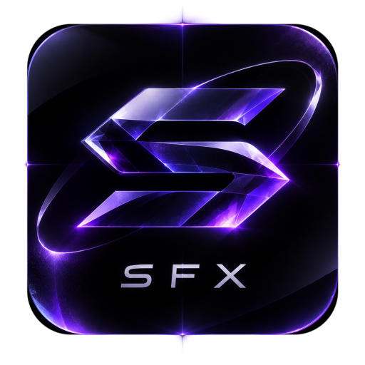

<p align="center">
  
</p>

<h1 align="center">SFX — Sound &amp; Special Effects</h1>

<p align="center">
  Видеоредактор и инструмент моушн-дизайна для Linux с интерфейсом и горячими клавишами в стиле After Effects<br>
  <i>A desktop video editor and motion-design tool for Linux with an After Effects–style workflow</i>
</p>

<p align="center">
  
  
  
  
  
</p>

---

## О проекте

**SFX** — настольное приложение для монтажа и моушн-дизайна. Оно сочетает быстрый монтаж в духе CapCut
с композициями, слоями, ключевыми кадрами, эффектами и 3D из After Effects. Интерфейс двуязычный
(русский / английский). Программа рассчитана на работу с геймплейными записями и роликами в 1080p60.

## Возможности

- **Интерфейс в стиле AE:** панель инструментов (V, H, Z, W, C, Y, Q, G, Ctrl+T), рабочие среды,
  Effect Controls (F3), сворачиваемые правые панели, сохраняемая раскладка окна.
- **Композиции и слои:** видео, картинки, звук, текст, солиды, шейп-слои, камеры, свет,
  корректирующие слои, прекомпозиция, родители, соло/блокировка, режимы наложения, трек-матты.
- **Анимация:** ключевые кадры (linear / Easy Ease / hold), граф-эдитор, панель Flow с кривыми,
  шаблоны анимаций, **выражения на JavaScript** (QJSEngine) с API в духе AE.
- **Монтаж:** разрезание, Ripple Delete, slip-монтаж, маркеры композиции и слоёв, прилипание,
  копирование/вставка, рабочая область.
- **Время:** скорость и спид-рампы, реверс, Time Remap, Freeze Frame, Posterize Time, Echo.
- **Эффекты:** размытие, свечение (Glow, Deep Glow), Shake, Wiggle, Curves, Levels, Keylight,
  Gradient Ramp, Motion Tile, глитчи, искажения и другие; эффекты в стиле Sapphire — собственные реализации.
- **Переходы:** 12 переходов (растворение, вспышка, зум, сдвиг, шторка, глитч, блик и др.), задаются как эффект на слое.
- **Маски и шейпы:** прямоугольник, эллипс, звезда, перо.
- **3D:** 3D-слои, камера, виды (спереди/сверху/свой вид), раскладка на 1/2/4 вида, гизмо осей, свет и тени.
- **Звук:** сведение, аудиоэффекты и эквалайзер, волна на таймлайне, поиск битов и прилипание к ним.
- **Roto Brush** на нейросети SAM 2.1 и **3D-трекер камеры** (OpenCV + SciPy) с экспортом в After Effects (.jsx).
- **Производительность:** фоновые процессы рендера, RAM-превью (Num 0), фоновое кэширование,
  прокси-файлы через NVENC, размытие на GPU (OpenGL).
- **Рендер:** форматы, кодеки (включая `h264_nvenc`), fps, качество, альфа-канал, PNG-секвенции, ProRes 4444.
- **Плагины** на Python (примеры — в `plugins_examples/`), автосохранение и восстановление после сбоя.

Полное описание всех функций и клавиш — в [руководстве пользователя](project-docs/USER_GUIDE.md).

## Технологии

| Компонент | Назначение |
|---|---|
| Python 3 | язык приложения |
| Qt 6 / PySide6 | интерфейс, OpenGL, QJSEngine для выражений |
| PyAV | декодирование видео и звука |
| NumPy | обработка кадров и эффекты |
| FFmpeg | экспорт, прокси, аудиоэффекты |
| PyTorch + SAM 2.1 *(опционально)* | Roto Brush |
| OpenCV + SciPy *(опционально)* | 3D-трекер камеры |

## Системные требования

- **ОС:** Linux. Разработка и проверка — на Arch Linux, Wayland (Hyprland).
- **Python:** 3.14 (на этой версии ведётся разработка и проверка).
- **FFmpeg** в системе (`ffmpeg` в `PATH`).
- **ОЗУ:** от 8 ГБ, рекомендуется 16 ГБ.
- **GPU** *(необязательно)*: NVIDIA с NVENC для быстрого экспорта и прокси; для Roto Brush нужна
  видеокарта с CUDA (проверено на RTX 3050 Laptop, 4 ГБ).

## Установка

```bash
git clone https://github.com/Kerstuan/sfx.git
cd sfx
./run.sh            # при первом запуске создаст .venv и поставит зависимости из requirements.txt
```

FFmpeg на Arch Linux: `sudo pacman -S ffmpeg`.

Дополнительные инструменты (Roto Brush и 3D-трекер) ставятся в отдельные окружения, основная программа от них не тяжелеет.
Ставить их заранее не нужно: при первом запуске инструмента SFX сам предложит скачать и установить его.
Можно поставить и вручную:

```bash
./install_roto.sh      # Roto Brush: PyTorch + SAM 2.1 (~3 ГБ, модель скачивается автоматически)
./install_tracker.sh   # 3D-трекер камеры: OpenCV + SciPy (~120 МБ)
```

## Запуск

```bash
./run.sh                    # главный экран «Проекты»
./run.sh video.mp4          # сразу с роликом
./run.sh project.skl        # открыть проект
```

## Примеры использования

**Быстрый эдит под музыку**
1. `Ctrl+I` — импортировать клипы и трек (или перетащить файлы в окно).
2. Включить отображение волны и битов, нарезать клипы по битам — слои прилипают к битам.
3. Добавить переходы (*Эффект → Переходы*) и Shake на ударах.
4. `Num 0` — RAM-превью, `Ctrl+M` — рендер.

**Анимация с выражением** — включить выражение у свойства и написать, например:
```js
wiggle(5, 20)
```

## Структура проекта

```
sfx/
├── main.py               # точка входа
├── run.sh                # запуск (создаёт .venv при первом запуске)
├── requirements.txt
├── install_roto.sh       # установка Roto Brush (SAM 2.1)
├── install_tracker.sh    # установка 3D-трекера
├── sfx/                  # исходный код приложения
│   ├── model.py          #   композиции, слои, свойства, ключи
│   ├── editor.py         #   состояние, выделение, undo, операции
│   ├── render.py         #   сборка кадра
│   ├── effects.py, fx_extra.py, sapphire.py, transitions.py   # эффекты и переходы
│   ├── media.py, proxy.py, cache.py                           # чтение видео, прокси, кэш
│   ├── render_service.py, render_worker.py, gpu.py            # фоновый и GPU-рендер
│   ├── audio.py, export.py, expressions.py                    # звук, экспорт, выражения
│   ├── shapes.py, three.py, lighting.py                       # маски, 3D, свет
│   ├── roto_worker.py, track_worker.py, camtrack.py           # Roto Brush и трекер
│   ├── i18n.py           #   перевод интерфейса
│   └── ui/               #   окно, вьювер, таймлайн, панели, диалоги
├── plugins_examples/     # примеры плагинов
├── tests/                # offscreen-тесты (tests/run_all.sh)
├── assets/               # исходники иконки
└── project-docs/         # документация
```

## Тесты

```bash
tests/run_all.sh
```

Тесты работают без окна (offscreen Qt), проверяют интерфейс на обоих языках и делают настоящие рендеры через FFmpeg.
Части тестов нужны локальные видеофайлы, пути к ним указаны в начале `tests/run_all.sh`.

## Участие в разработке

Проект открыт для сообщества: делайте Fork, исправляйте баги, добавляйте функции и присылайте Pull Request.
Перед отправкой прогоните тесты (`tests/run_all.sh`).

## ☕ Поддержать автора / Support the author

Привет! Меня зовут **Kerstuan**, и SFX я делаю один, в свободное время, с большой любовью к монтажу и моушн-дизайну.
Проект бесплатный и останется таким. Если SFX сэкономил тебе время, помог сделать крутой эдит или просто понравился,
можешь поддержать меня небольшим донатом. Это помогает развивать проект и добавлять новые функции.

*Hi! I'm **Kerstuan**, and I build SFX on my own, in my free time, out of a love for editing and motion design.
SFX is free and always will be. If it saved you time, helped you make an awesome edit, or you simply enjoy it,
you can support me with a small donation. It helps keep the project growing and new features coming.*

**TRON (TRC20):**
```
TUTPteCshhfb7wdnzaDmuEkRfXt5k8h4tD
```
⚠️ Отправляй только через сеть **TRON (TRC20)**, иначе средства могут потеряться. /
*Please send only via the **TRON (TRC20)** network, or the funds may be lost.*

Не можешь задонатить? Ничего страшного! Звёздочка ⭐ на GitHub, отзыв или рассказ другу тоже очень помогают. Спасибо, что ты здесь 💙
*Can't donate? No worries at all! A ⭐ on GitHub, some feedback, or telling a friend helps a lot too. Thanks for being here 💙*

## Credits

- **Kerstuan** — первоначальный автор и разработчик SFX.
- Изменения в форках и производных версиях принадлежат их авторам, но Fork не делает человека
  первоначальным автором проекта: оригинальное авторство Kerstuan сохраняется.
- Сторонние библиотеки (Qt/PySide6, PyAV, NumPy, FFmpeg, PyTorch, SAM 2.1, OpenCV, SciPy) принадлежат своим авторам
  и распространяются по своим лицензиям. В репозиторий они не входят и ставятся отдельно.
- After Effects и Sapphire — товарные знаки их правообладателей; SFX с ними не связан.

## Лицензия

Распространяется по лицензии **[MIT](LICENSE)**. Copyright (c) 2026 Kerstuan.

Код можно свободно использовать, изменять, распространять и применять в том числе в коммерческих проектах.
Единственное условие: **во всех копиях и существенных частях кода нужно сохранять уведомление
`Copyright (c) 2026 Kerstuan` и текст лицензии MIT.** Удалять оригинальный копирайт из распространяемых копий нельзя.
